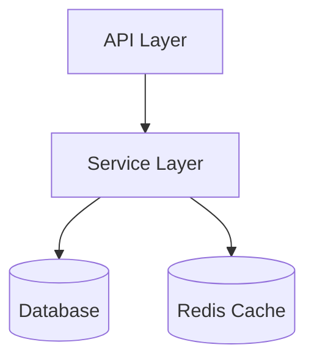

# Export Conversation - Claude Code Skill

> 📝 Export your Claude Code conversation sessions to beautifully formatted markdown files with diagrams, statistics, and full conversation history.

[](https://claude.ai/code)
[](./LICENSE)

## Features

✨ **Comprehensive Exports** - Captures complete conversation history with user messages, assistant responses, and all tool usage

📊 **Visual Diagrams** - Automatically generates Mermaid diagrams for:
- Code architecture and system design
- Process flows and workflows  
- Sequence diagrams for API calls
- File structure trees
- Git operations and branching
- State machines and data flows

📈 **Session Statistics** - Tracks files modified, commands executed, and key outcomes

🎯 **Flexible Output** - Auto-timestamped files or custom naming

🔒 **Privacy-Aware** - Sanitizes sensitive information (API keys, passwords)

## 3.0.0 - harness-agnostic core

Version 3.0.0 turns the skill into a dependency-free conversation data platform. The core does not import a harness SDK, an LLM client, an MCP SDK or a paid service. Harness support is an optional adapter layer.

```bash
node scripts/conversation.mjs doctor
node scripts/conversation.mjs adapters
node scripts/conversation.mjs discover --root ~/.claude
node scripts/conversation.mjs import --adapter claude-code --input session.jsonl --project "E:\Projects\Anvil"
node scripts/conversation.mjs list --project "E:\Projects\Anvil"
node scripts/conversation.mjs search --text "coverage" --project "E:\Projects\Anvil"
node scripts/conversation.mjs verify --all --project "E:\Projects\Anvil"
node scripts/conversation.mjs export --id <id> --format md --project "E:\Projects\Anvil"
node scripts/mcp-server.mjs --self-test
```

Each conversation lives under `<project>/.export/conversations/<id>/` with immutable `raw/records.jsonl`, a deterministic `view/conversation.json`, a capture ledger, a hash-chained `revisions/` directory and transactional recovery. Writes are staged, backed up, journaled and renamed; interrupted writes are rolled back by `conversation recover`.

Coverage has three independent dimensions - `source`, `selection` and `export` - plus an explicit source boundary. `COMPLETE` is only reported relative to that boundary. Legacy free-text "complete" claims are migrated to `UNKNOWN` source coverage with `RECONSTRUCTED` provenance.

| Adapter | Kind | Evidence |
| --- | --- | --- |
| `claude-code` | native | live JSONL structure observed |
| `codex` | native | fixture-verified |
| `gemini-cli` | native | official session JSONL format |
| `chatgpt-export` | official export | synthetic ZIP tree fixture |
| `openhands-transcript` | official export | fixture-verified Markdown/HTML |
| `freebuff-thread-context` | native context | context payload only |
| `generic-json`, `generic-jsonl` | generic import | implemented and tested |

Adapters never install a harness, bypass authentication or read a private store without an explicit readable path. A context payload is never labelled complete history.

## Verification, safety and continuity (2.2.1 foundation)

The skill no longer trusts a fence count. Every export passes four gates:

- **Redaction first** - `scripts/redact.mjs` scans for private keys, provider tokens, credential assignments, bearer tokens and credential URLs. Check mode reports line and type only, never the value; `--write` replaces matches with `[REDACTED]`.
- **Real rendering** - `scripts/render-mermaid.mjs` extracts every block, lints the diagram type and labels, renders SVG and PNG, measures the canvas, flags extreme aspect ratios and missing text, and writes a JSON manifest. `--gallery` builds an HTML review page.
- **Document validation** - `scripts/validate-export.mjs` checks front matter, required sections, message markers, coverage, secrets and the render manifest.
- **Incremental updates** - `scripts/merge-export.mjs` merges a fresh export into an existing document without duplicating messages and preserves `<!-- export:manual:... -->` blocks.

Supporting tools: `scripts/install-skill.mjs` installs into every detected agent root and reports drift with `--check`; `scripts/assets.mjs` copies local images and fills alt text; `scripts/validate-release.mjs` checks versions, manifest, docs and plugin metadata.

## Project-scoped exports (`.export`)

Exports can belong to a project instead of being written next to source files:

```text
<project>/.export/conversations/<conversation-id>/export.md
```

Destination priority is explicit `--destination`, explicit `--project`, then the actual detected project root. The resolver uses Git or a project marker and refuses to guess; it does not default to the open chat's project, the home directory or a temporary cwd.

```bash
# Resolve without writing
node skills/export/scripts/project-export.mjs resolve --destination "E:\Projects\Anvil"

# Focused export: only this conversation, no project index
node skills/export/scripts/project-export.mjs add \
  --source focused-export.md --destination "E:\Projects\Anvil" \
  --conversation-id conv-redaction-bug --title "Redaction bug"

# Deliberate archive for multiple conversations
node skills/export/scripts/project-export.mjs add \
  --source verified.md --destination "E:\Projects\Anvil" \
  --archive --conversation-id conv-architecture --title "Architecture"

# Continue one conversation without touching the others
node skills/export/scripts/project-export.mjs add \
  --source updated.md --destination "E:\Projects\Anvil" \
  --update --conversation-id conv-architecture

# Inspect and verify
node skills/export/scripts/project-export.mjs list --destination "E:\Projects\Anvil"
node skills/export/scripts/project-export.mjs verify --destination "E:\Projects\Anvil"
```

A focused export writes only its conversation directory. `project.json`, `index.md` and `README.md` appear only after a deliberate archive initialisation. Each conversation has stable identity, metadata, revision and a SHA-256 integrity hash. `filter` selects message ranges into an explicitly partial export; `overview` generates a project summary without modifying source exports. See [docs/PROJECT-EXPORTS.md](docs/PROJECT-EXPORTS.md).

## Quick Start

### Installation

#### From Claude Code CLI (Recommended)

Once this plugin is available in a marketplace:

```bash
/plugin install export-conversation
```

#### Manual Installation

1. **Clone or download this repository:**
   ```bash
   git clone https://github.com/Alot1z/export-conversation-skill.git
   ```

2. **Load the plugin:**
   ```bash
   # Test locally during development
   claude --plugin-dir ./export-conversation-skill
   
   # Or install permanently by copying to plugins directory
   cp -r export-conversation-skill ~/.claude/plugins/export-conversation
   ```

3. **Verify installation:**
   ```bash
   # In Claude Code session
   /help
   ```
   
   You should see `/export-conversation:export` listed under available skills.

## Usage

### Basic Usage

Export current conversation with auto-generated timestamp:
```bash
/export-conversation:export
```
Creates: `conversation-export-2026-04-08-203940.md`

### Custom Filename

Export to a specific filename:
```bash
/export-conversation:export my-session
```
Creates: `my-session.md`

### Custom Path

Export to a specific directory:
```bash
/export-conversation:export docs/sessions/planning-session
```
Creates: `docs/sessions/planning-session.md`

**Note:** Plugin skills are namespaced (`:export`) to prevent conflicts with other plugins.

## What Gets Exported

Each export includes:

### 1. Session Metadata
- Export timestamp
- Working directory
- Conversation summary (2-3 paragraph overview)

### 2. Visual Overview (When Applicable)
Automatically generated Mermaid diagrams for:
- **Architecture diagrams** - Component relationships and dependencies
- **Sequence diagrams** - API calls, method invocations, request/response flows
- **Flowcharts** - Process flows, decision trees, workflows
- **File structure** - Directory trees and file organization
- **Git graphs** - Branching strategies and commit history
- **State diagrams** - State machines and UI states
- **ER diagrams** - Database schemas and entity relationships

### 3. Full Conversation History
- Chronological message-by-message capture
- User messages and assistant responses
- All tool calls with descriptions (Bash, Read, Write, Edit, etc.)
- Errors encountered and resolutions
- Code snippets (when relevant)

### 4. Session Statistics
- Total message count
- Files created and modified
- Commands executed
- Key outcomes and achievements

### 5. File Change Log
Detailed documentation for each file:
- Action taken (Created/Modified/Deleted)
- Description of changes
- Relevant code snippets

## Examples

### Example 1: Simple Export

```bash
/export-conversation
```

**Output:**
```
✓ Conversation exported to: /Users/you/project/conversation-export-2026-04-08-143022.md

The export includes:
- Full conversation history (12 messages)
- 3 files modified
- 8 commands executed
- 0 Mermaid diagrams
- Session summary and statistics
```

### Example 2: Export with Diagrams

When you discuss architecture, the skill automatically includes relevant diagrams:

```bash
/export-conversation architecture-planning
```

**Output:**
```
✓ Conversation exported to: /Users/you/project/architecture-planning.md

The export includes:
- Full conversation history (25 messages)
- 8 files modified
- 15 commands executed
- 4 Mermaid diagrams
- Session summary and statistics
```

The export will contain diagrams like:



### Example 3: Review Session Export

```bash
/export-conversation code-review-session
```

Perfect for documenting:
- Code review discussions
- Bug investigation sessions
- Architecture planning meetings
- Feature development sessions
- Debugging sessions

## When to Use

**Perfect for:**
- 📚 **Documentation** - Create permanent records of important sessions
- 🔍 **Code Reviews** - Export review discussions with full context
- 🏗️ **Architecture Planning** - Capture design decisions with diagrams
- 🐛 **Bug Investigations** - Document debugging sessions step-by-step
- 📖 **Learning** - Save educational sessions for future reference
- 🤝 **Team Sharing** - Share conversation context with team members
- 📝 **Project History** - Build a knowledge base of project decisions

## Diagram Support

The skill intelligently determines when to create diagrams based on conversation content:

| Diagram Type | Use Case | Example |
|--------------|----------|---------|
| `graph TD/LR` | Architecture, dependencies, file trees | Component relationships |
| `sequenceDiagram` | API calls, method flows | Request/response patterns |
| `flowchart` | Processes, decision trees | Workflow logic |
| `classDiagram` | OOP design, class relationships | Class hierarchies |
| `stateDiagram-v2` | State machines, UI states | State transitions |
| `gitGraph` | Git operations, branching | Branch strategies |
| `erDiagram` | Database schemas | Entity relationships |

### Diagram Quality Standards

The skill ensures diagrams are:
- ✅ Focused on one concept per diagram
- ✅ Using clear, descriptive labels
- ✅ Showing actual names from your conversation
- ✅ Indicating flow direction with arrows
- ✅ Self-explanatory with context

### Validation

A fence count is not validation. `skills/export/scripts/render-mermaid.mjs` extracts every fenced block, renders SVG and PNG with Mermaid CLI, prints a size table and exits non-zero on syntax or renderer failures:

```bash
node skills/export/scripts/render-mermaid.mjs my-export.md --out target/mermaid
```

Inspect the PNGs for clipped labels, overlapping tags and extreme aspect ratios before sharing an export.

## Privacy & Security

- **Automatic sanitization** - Sensitive data (API keys, passwords) replaced with `[REDACTED]`
- **Local-only** - Exports are saved to your local filesystem
- **No external uploads** - Your conversations stay on your machine

## File Structure

```text
export-conversation-skill/
├── core/                        # Dependency-free canonical engine
│   ├── canonical.mjs            # Schema 2 model and hashing
│   ├── store.mjs                # Transactions, locks, revisions, recovery
│   ├── coverage.mjs             # Three dimensions plus source boundary
│   ├── verify.mjs               # Dimensioned verification
│   ├── ingest/                  # ZIP, JSON, JSONL, Markdown, HTML, SQLite
│   ├── render/                  # Markdown, JSON, HTML
│   └── query.mjs, reconstruct.mjs, migrate.mjs, registry.mjs, service.mjs
├── adapters/                    # Optional harness data sources
├── catalogue/harnesses.json     # Offline harness catalogue
├── schemas/                     # Canonical, adapter and package schemas
├── scripts/
│   ├── conversation.mjs         # CLI
│   ├── mcp-server.mjs           # Dependency-free MCP stdio server
│   ├── render-mermaid.mjs       # Render, lint, manifest, gallery
│   ├── redact.mjs               # Secret gate
│   ├── merge-export.mjs         # Incremental merge
│   ├── validate-export.mjs      # Document validator
│   ├── project-export.mjs       # Legacy .export compatibility
│   └── assets.mjs
├── skills/export/               # Skill instructions and manifest
├── tools/                       # build-package.mjs, bench.mjs
├── tests/                       # Unit, crash, adapter, CLI and MCP tests
├── docs/                        # Architecture, adapters, security, migration
├── README.md
└── LICENSE
```

## Advanced Tips

### 1. Create a Documentation Workflow

Add to your `.claude/CLAUDE.md`:
```markdown
# Project Documentation
After completing significant features or architectural decisions, 
run `/export-conversation feature-name` to document the session.
```

### 2. Combine with Git

```bash
# After a productive session
/export-conversation feature-auth-implementation

# Add to git
git add docs/sessions/feature-auth-implementation.md
git commit -m "docs: Add session notes for auth implementation"
```

### 3. Team Knowledge Base

Export important sessions to a shared docs folder:
```bash
/export-conversation docs/team-sessions/2026-04-08-api-redesign
```

## Troubleshooting

### Skill Not Found

If `/export-conversation` is not recognized:

1. Verify installation:
   ```bash
   ls ~/.claude/skills/export-conversation/SKILL.md
   ```

2. Check file permissions:
   ```bash
   chmod 644 ~/.claude/skills/export-conversation/SKILL.md
   ```

3. Restart Claude Code CLI or reload your session

### Exports Missing Diagrams

Diagrams are only included when:
- Code architecture or system design was discussed
- Process flows or workflows were created
- File/directory structure was modified
- Component relationships were explained

For simple Q&A sessions without architectural discussion, no diagrams are generated.

### Custom Diagram Requests

If you want to ensure diagrams are included, explicitly discuss architecture during your session:
- "Let's diagram the component architecture"
- "Show me the flow of this process"
- "What's the file structure we created?"

## Contributing

Contributions are welcome! Here's how:

1. Fork the repository
2. Create a feature branch: `git checkout -b feature/amazing-improvement`
3. Make your changes to `SKILL.md`
4. Test thoroughly in a Claude Code session
5. Commit with clear messages: `git commit -m 'feat: Add support for X'`
6. Push to your fork: `git push origin feature/amazing-improvement`
7. Open a Pull Request

### Development Setup

```bash
# Clone your fork
git clone https://github.com/Alot1z/export-conversation-skill.git

# Create symlink for development
ln -s $(pwd)/export-conversation-skill ~/.claude/skills/export-conversation

# Make changes to SKILL.md
# Test in Claude Code with /export-conversation
# Changes take effect immediately
```

## Changelog

### v3.0.0 - 2026-11-22

- Dependency-free canonical core with immutable raw records, deterministic views, transactional storage, recovery, revisions and dimensioned verification.
- Adapter layer for Claude Code, Codex, Gemini CLI, ChatGPT exports, OpenHands transcripts, Freebuff context and generic JSON/JSONL.
- CLI and MCP surfaces, schema-1 migration with verified backups and a reproducible package builder.
- Three independent coverage dimensions plus an explicit source boundary; legacy "complete" claims are no longer trusted.

### v2.2.1 - 2026-11-21

- Redaction scans mixed placeholder/secret lines and is idempotent.
- Merge preserves manual blocks found only in the old export.
- Installed roots receive runtime files only; stale dev tooling is reported and pruned.
- Added safe project installation with `--project`.
- Added project-scoped `.export` storage with destination resolution, focused and archive modes, stable conversation identity, filtering, index, update/merge, archive, overview and integrity verification (`scripts/project-export.mjs`).
- Added `schemas/project-export.schema.json` and [project export documentation](docs/PROJECT-EXPORTS.md).

### v2.2.0 - 2026-11-21
- Redaction gate for secrets, credentials and optional paths/emails
- Step 4b render validation with manifest, gallery, lint and layout warnings
- Step 4c document validator and incremental Step 4d merge
- Multi-root installer with drift detection
- Cross-platform tests and CI matrix

### v2.0.0 - 2026-04-08
- ✨ Added comprehensive Mermaid diagram support
- ✨ 7 diagram types: graph, sequence, flowchart, class, state, git, ER
- 📝 Enhanced Visual Overview section
- 📝 Diagram quality standards and guidelines
- 🎯 Smart diagram inclusion based on conversation content

### v1.0.0 - 2026-04-08
- 🎉 Initial release
- ✨ Basic conversation export functionality
- ✨ Session statistics tracking
- ✨ File change logging
- ✨ Flexible output naming (timestamp or custom)
- 🔒 Sensitive data sanitization

## Development

```bash
node --test                                        # all unit, crash, adapter, CLI and MCP tests
RUN_MERMAID=1 node --test tests/render-mermaid.test.mjs  # real Mermaid render (slow)
node tools/bench.mjs --profile=smoke               # local pipeline measurements
node scripts/conversation.mjs doctor
node skills/export/scripts/validate-release.mjs
node tools/build-package.mjs --clean --out ../.account-package
node skills/export/scripts/install-skill.mjs --check
```

CI runs the test suite on Ubuntu, Windows and macOS with Node 20 and 22, plus a real render job. The release workflow verifies a `v*` tag without publishing anything.

## License

MIT License - see [LICENSE](./LICENSE) file for details

## Acknowledgments

Built for [Claude Code](https://claude.ai/code) by Anthropic

## Support

- 🐛 [Report Issues](https://github.com/Alot1z/export-conversation-skill/issues)
- 💡 [Request Features](https://github.com/Alot1z/export-conversation-skill/issues/new)
- 📖 [Claude Code Documentation](https://docs.anthropic.com/claude/docs/claude-code)

---

**Made with ❤️ for the Claude Code community**
